# Demo Project - Create CI Pipeline (Freestyle, Pipeline, Multibranch Pipeline)

## Overview
Install build tools in Jenkins and create CI pipelines using chained freestyle jobs, a pipeline and a multibranch pipeline.

## Technologies used: 
Jenkins, Docker, Linux, Git, Java, Maven 

## Project Description: 
CI Pipeline for a Java Maven application to build and push to the repository 
* Install Build Tools (Maven, Node) in Jenkins
* Make Docker available on Jenkins server
* Create Jenkins credentials for a git repository
* Create different Jenkins job types (Freestyle, Pipeline, Multibranch pipeline) for the Java Maven project with Jenkinsfile to:
  - Connect to the application’s git repository
  - Build JAR
  - Build Docker Image
  - Push to private DockerHub repository

## Install Build Tools 
### Install Maven
1. Log into Jenkins and go to "Manage Jenkins" by clicking on the Gear icon on the top right
2. Click on Tools 
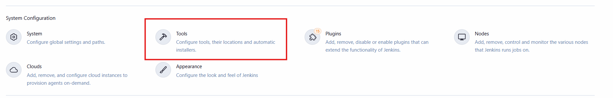
3. Scroll down and Click on "+ Add Maven" button 
4. In the Name field, enter a value such as "maven-3.9"
5. Select the desired version under "Install from Apache" block
6. Click "Apply" and "Save"
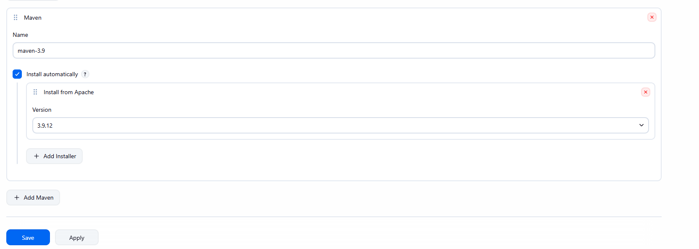

### Install Node.js and npm
1. Log into the Jenkins container as root by running the following command

``` 
docker exec -it -u 0 <container ID or name> bash
```
2. Update the package list and install Node.js and npm by running the following commands:

```
apt update
apt install -y nodejs npm
```
3. Verify node.js and npm packages are installed

```
node -v
npm -v
```


## Create Simple Freestyle job with GitHub repository
1. Click create "Create a job"
    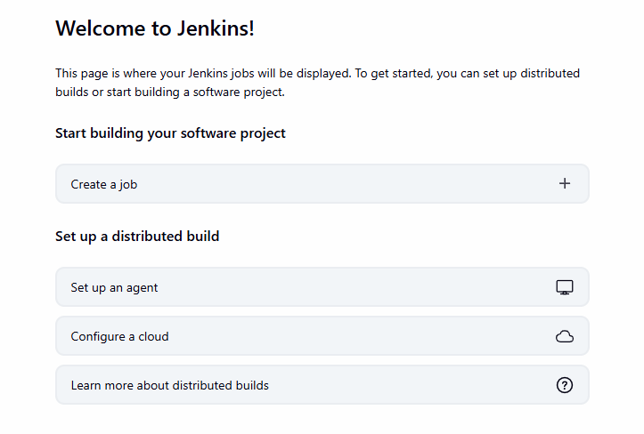
2. Enter a name for job. For example, you can enter "my-freestyle-job"
3. Select "Freestyle project" and click "Ok" button
   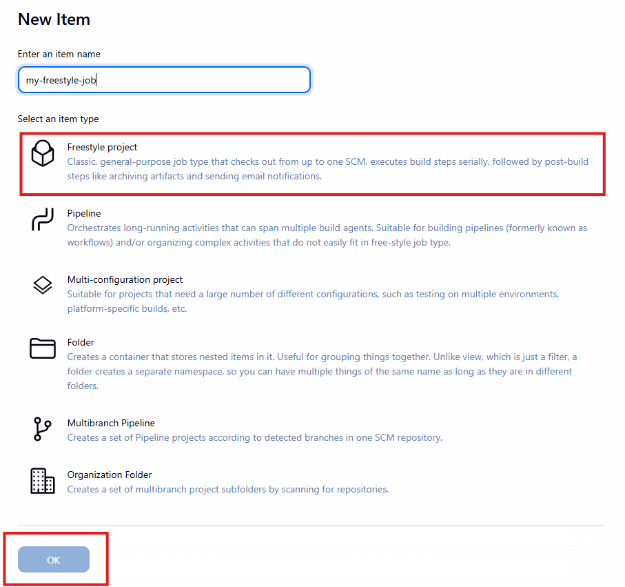
4. In the next screen, you have various options to build steps of the job. For example , you can click on the "+ Add build step" and select "Execute shell" to run arbitrary shell commands (such as ls, echo, docker builder etc.) and scripts.
   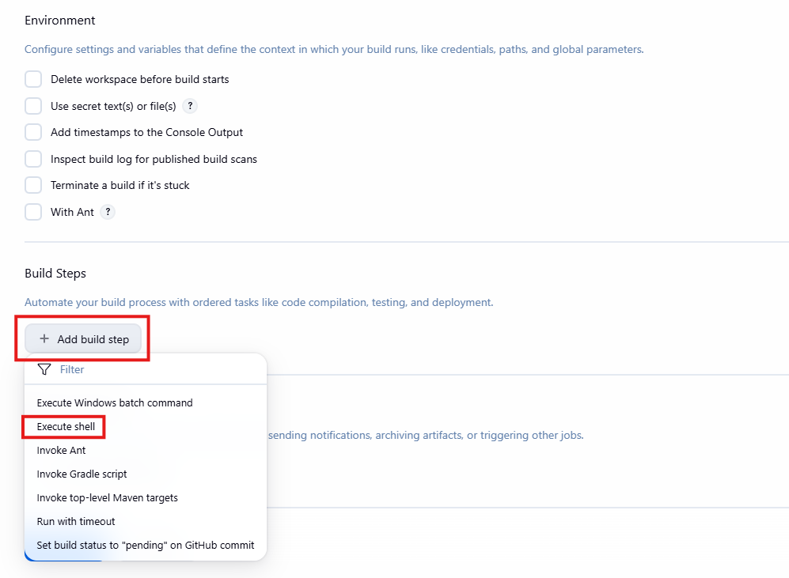
   We will enter simple commands as shown below and save the job:
   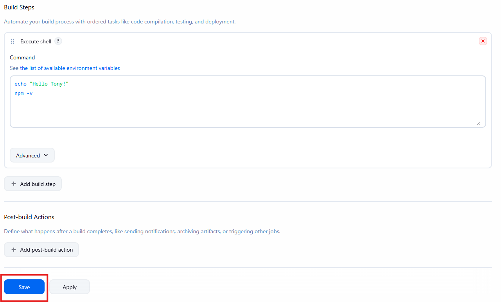
5. Once the job is saved, you can see the job from the dashboard on the home page:
   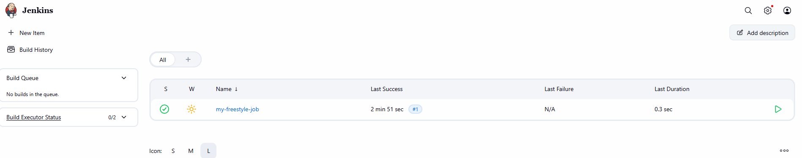
6. Click on the job and you will see various options such as "Configure" to modify the job and "Build Now" to run the job.   
7. Click on "Build Now" and check the status of the build:
    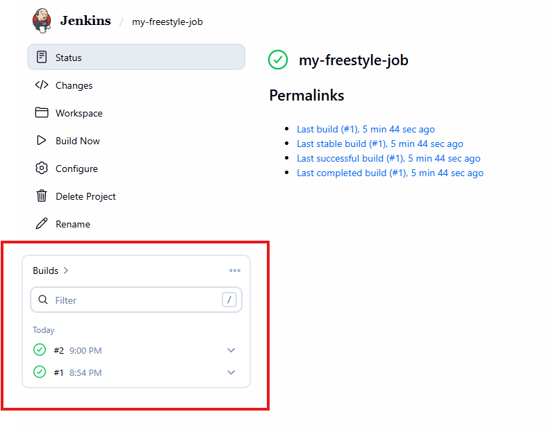
8. You can click on the builder number (for example "#2" as shown above) to view details of the build.
   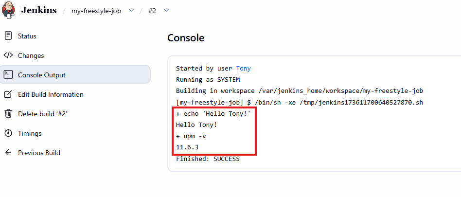
9. Let's modify our freestyle job by adding a build step to invoke Maven and check for its version:
    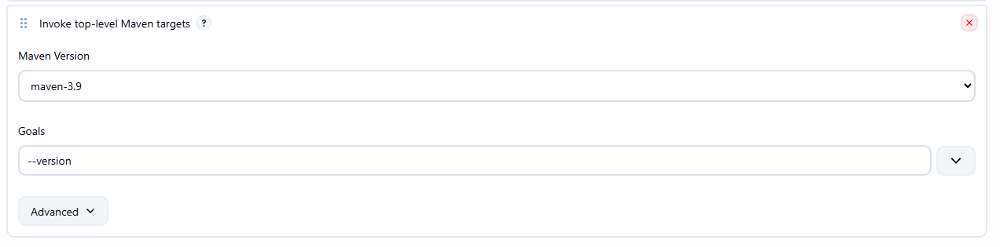
10. Save the changes and click "Build Now" to re-run the job. You will see a different output compared to the last build:
    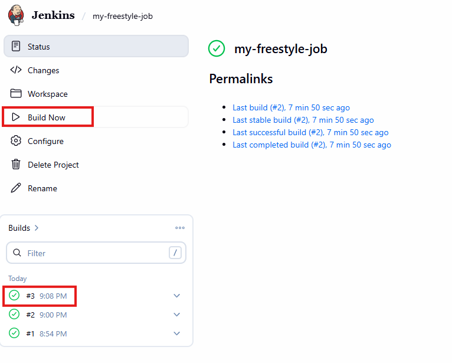
    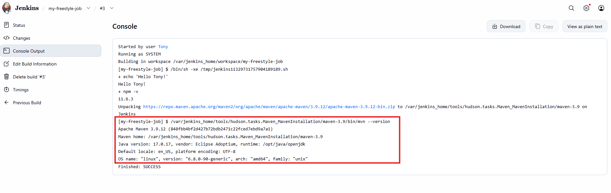
11. As you can see above, even though we installed nodejs and npm via command line instead of plugin, it offers much more flexibility since we can easily run multiple commands and scripts in the "Execute shell" option. With a plugin, you are limited to the input fields provided by the plugin offering less flexibility.

## Create Freestyle job with GitHub repository
To build code directly from a GitHub repository using Jenkins, you can create a Freestyle job and configure Jenkins to pull code from source control automatically. Because GitHub requires authentication to access private repositories, Jenkins needs valid credentials. 

In this setup, I configured Jenkins to authenticate using a GitHub Personal Access Token (PAT). The PAT is stored securely under Jenkins → Credentials, and the credentials are then linked to the Freestyle job. Jenkins uses the token to clone the repository during each build, enabling automated pulls without manual login.

1. Create a new Freestyle job and select "Git" under Source Code Management block
	- Enter repository URL and create Credentials for PAT for Jenkins to access GitHub account
	- We will use the branch "jenkins-branch" to run the following build steps:
		- Maven test
 		- Maven package

2. Save the job and run "Build now" to launch it.


